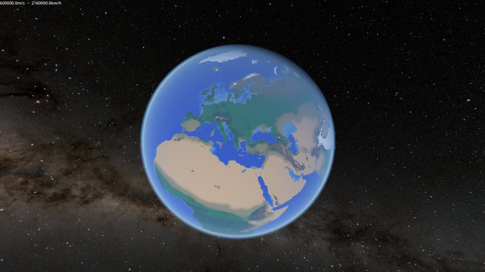
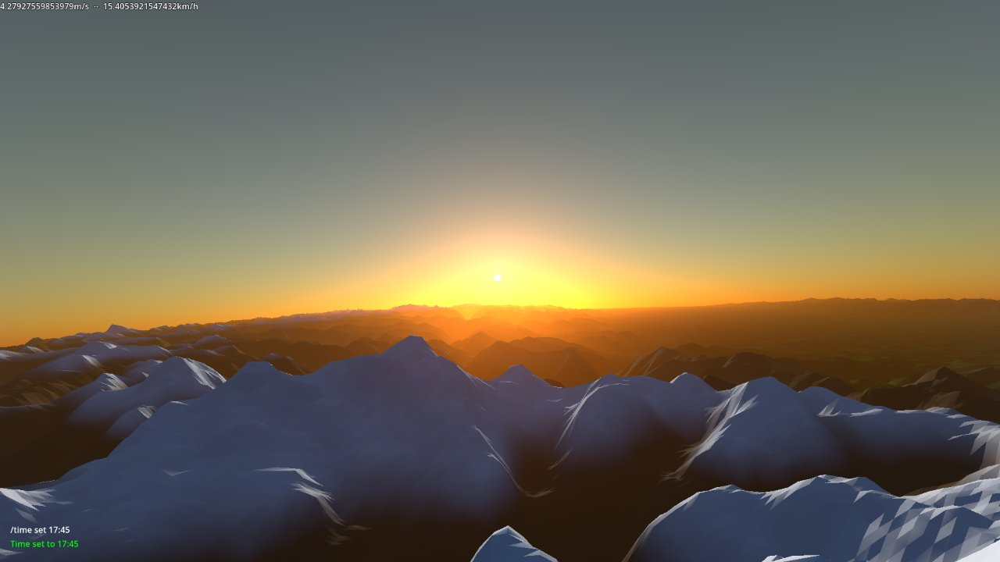
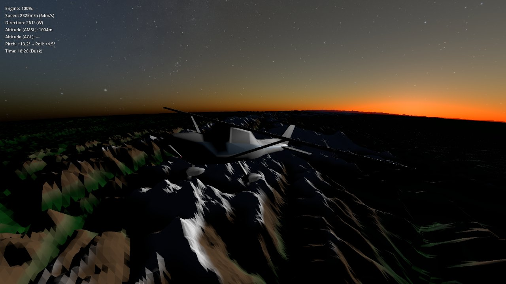

# Into the Night

Currently a Planet Renderer and basic flight sandbox (built with godot 4)

## Features
- **Cube-sphere planet with quadtree LOD:** terrain is split into chunks that subdivide as the camera gets closer
- **Real elevation data:** terrain can be generated from ETOPO global elevation data, equirectangular images or procedural noise
- **Shader:** terrain, water and atmospheric scattering
- **Flyable Plane** with a basic flight HUD
- **In-game command console:** a command tree with typed arguments and its own parser

## Running
Follow steps in 'tools/install.txt', to install etopo data, to see the real planet
Open Project in godot 4 and press play

## Folder Structure
##### 'Planet/':
- LOD quadtree, chunks, terrain sampling, planet/watmosphere/water shader
##### 'Planet/TerrainSource/':
- ETOP, image, equirect, disk and noise height sources
##### 'Plane/':
- Arcade style plane and HUD
##### 'Chat/':
- Command Console: parser, command tree, commands

---

The Core of the project is my own work. I used AI assistance later in the project for the Python preproceesing scripts
that convert the raw ETOPO elevation data into the tile format the game loads. I reviewed and understand it nonetheless.
